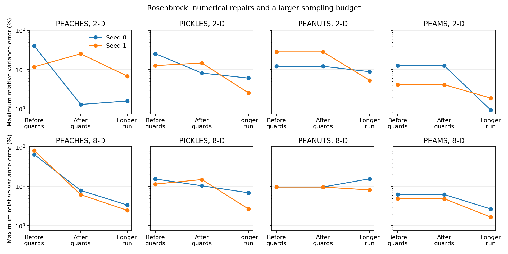

# Ensemble Hamiltonian samplers on Rosenbrock

The numerical guards removed zero-length trajectories in the observed failing
PEACHES/PICKLES cases. Every corrected run was finite and moved. Gaussian
accuracy does not imply equally fast sampling of the curved Rosenbrock valley:
the learned length, initialization, and sampling budget still matter.

## Protocol

The target is a product of independent pairs, with
`log pi(x)=-sum((x_even-1)^2+100*(x_odd-x_even^2)^2)`.
Equivalently, `X~N(1,.5)` and `Y=X^2+E`, `E~N(0,.005)` independent.
Coordinate means are `1/1.5`, variances `.5/2.505`. This is the repository's
paired Rosenbrock, rather than the chained optimization benchmark.

All cases used float32, 64 walkers, dimensions 2/8, sampler seeds 0/1,
and unit Gaussian starts at key `42+seed`. Each start was prepared by stretch
with 100 warmup plus 100 production iterations at that same sampler seed.
The resulting ensemble was passed identically to all four methods.
Preparation costs 12,864 log-density evaluations, including the initial one.
The older short-run files recorded 12,800, excluding that initial evaluation.
The before/after comparison used 750 warmup and 3,000 production iterations,
`max_L=20` or `max_tree_depth=5`. The longer study used 1,000 warmup and
10,000 production iterations, `max_L=128` or `max_tree_depth=8`.
It changes both warmup and available trajectory length, so it does not isolate
the effect of a larger production budget.

Stored metadata identifies the source hashes and settings for each run. These
studies predate the conditional full-ensemble warmup metric repair; that repair
does not trigger here because the complement has 32 walkers and D is 2 or 8.
The historical failures retain their original recorded trajectory/cost fields,
which were unreliable when nominal L became zero. Do not use those costs to
rank efficiency.



The before/after comparison preserves all seeds. Three PEACHES cases reported
mean L=0; the D=2, seed=0 PICKLES case made no moves and had ESS=0 despite
acceptance=1. The actual-time tuning correction was already present in this
comparison; the new difference is the numerical guard repair.

## Accuracy and cost after the repair

Each cell below shows the range across both seeds. Variance error is the
largest relative coordinate error. ESS counts effective **ensemble averages**,
taking the minimum over coordinates, coordinate squares, banana residuals,
and squared residuals. Production gradient counters exclude preparation and
warmup. PEANUTS reports logical active-tree work; vectorization may execute
additional padded work, so its counter is not device FLOPs.

| Run | D | Sampler | Maximum variance error | Minimum observable ESS | Production gradients (millions) |
|---|---:|---|---:|---:|---:|
| After guards | 2 | PEACHES | 1.3–25.4% | 20.4–36.5 | 1.36–3.14 |
| After guards | 2 | PICKLES | 8.2–14.8% | 15.5–27.7 | 0.99–1.83 |
| After guards | 2 | PEANUTS | 12.2–28.4% | 9.4–67.6 | 3.42–4.25 |
| After guards | 2 | PEAMS | 4.2–12.7% | 49.4–63.1 | 3.70–3.81 |
| After guards | 8 | PEACHES | 6.2–8.0% | 14.9–16.7 | 2.06–2.52 |
| After guards | 8 | PICKLES | 10.4–15.1% | 19.8–22.9 | 3.02–3.83 |
| After guards | 8 | PEANUTS | 9.7–9.7% | 23.1–35.1 | 9.35–9.36 |
| After guards | 8 | PEAMS | 4.9–6.3% | 38.5–58.6 | 4.01–4.03 |
| Longer run | 2 | PEACHES | 1.6–6.9% | 11.0–95.9 | 3.79–11.90 |
| Longer run | 2 | PICKLES | 2.6–6.1% | 182.6–373.2 | 20.44–57.63 |
| Longer run | 2 | PEANUTS | 5.4–8.9% | 16.3–25.3 | 12.26–13.28 |
| Longer run | 2 | PEAMS | 0.9–1.9% | 203.0–272.7 | 14.56–15.24 |
| Longer run | 8 | PEACHES | 2.5–3.4% | 70.5–161.2 | 15.81–15.95 |
| Longer run | 8 | PICKLES | 2.7–6.9% | 18.3–79.3 | 5.65–15.54 |
| Longer run | 8 | PEANUTS | 8.2–15.7% | 12.7–28.1 | 61.34–62.66 |
| Longer run | 8 | PEAMS | 1.7–2.7% | 152.3–224.3 | 19.87–21.35 |

PEAMS gave the most consistent moments in the longer comparison: maximum
variance errors were 0.9–2.7%, with minimum observable ESS 152–273. PEACHES
reached 2.5–3.4% errors in 8-D; its 2-D seed 1 still learned short trajectories
and had only about 11 effective averages for the slowest observable. PICKLES
generally improved its moments, but one run learned mean L about 90 and spent
57.6 million gradients. Raising PEANUTS's depth from 5 to 8 was costly and did
not consistently improve accuracy or observable ESS. These results support
measuring a capacity increase, rather than assuming it always helps efficiency.

The [fixed-L check](rosenbrock_fixed_l/findings.md) compares a simple alternative
for PEACHES/PICKLES using the same prepared starts. It is an option to compare,
with mixed outcomes, rather than an applied default.

## Practical choices supported by these checks

For this stiff paired target, give warmup enough iterations and keep the
initial ensemble dispersed along the valley. Inspect realized mean L and cap
hit rate alongside movement, moments, and ESS of squared observables. A high
acceptance rate with very short trajectories can still mix slowly. If adaptation
chooses a poor length, compare a fixed L under the same gradient budget.
Compare independent ensemble seeds before trusting tail moments.

PEACHES/PICKLES/PEAMS dual averaging uses a harmonic mean of per-walker
acceptance probabilities, with default target .651. The reported fraction of
accepted moves and arithmetic mean acceptance are different statistics; they
need not match that target. The new harmonic-acceptance field helps interpret
whether step-size tuning is meeting its intended criterion.

PEAMS is a useful first comparison for this Rosenbrock protocol. PEACHES and
PICKLES also produced reasonable moments with the corrected warmup, but their
cost and slowest-observable mixing varied more between seeds. PEANUTS remains
an option whose tree depth should be justified by measured cost and mixing.
Affine invariance handles linear distortion; a curved narrow valley can remain
hard for these methods and for gradient-free affine samplers.

## Reproduce

From the repository root, use a new output directory to preserve stored results:

```bash
JAX_PLATFORMS=cpu PYTHONPATH=src python audit/robustness/benchmark_rosenbrock_hmc.py --output-dir /tmp/rosenbrock-short
JAX_PLATFORMS=cpu PYTHONPATH=src python audit/robustness/benchmark_rosenbrock_hmc.py --warmup 1000 --production 10000 --max-L 128 --max-tree-depth 8 --output-dir /tmp/rosenbrock-long
python audit/robustness/summarize_rosenbrock_hmc.py
```

The sampler scripts use the source in the current checkout. The summary script
only reads the stored result files. Exact regeneration of a historical failed
run requires its recorded source snapshot; a newer checkout intentionally fixes
those paths. ESS uses a self-consistent ACF window with IAT capped at one, not
rank-normalized convergence diagnostics. Some traces fail the 50-times-IAT
length heuristic. Two seeds cannot establish a universal sampler ranking.
